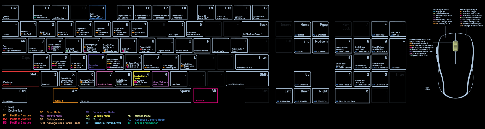

# Star Citizen — In-Game Settings

Required custom bindings for this layout and suggested quality-of-life changes.

## Required in-game bindings

Steam Input sends the keys below; configure the matching actions in Star Citizen.

### Inspect Item

Bind **Inspect Item** to the **letter `O` (not zero `0`)** in **Options → Keybindings → Advanced Controls Customization → On Foot - All**. The layout exposes it as **M1 + R3 [H]** in FPS Mode. This custom binding is required to use Inspect Item.

You can choose a different in-game key if you prefer. Afterward, edit the FPS L4 modifier layer in Steam Input so **R3's Long Press** sends that same key instead of `O`.

### Cycle mouse mode

Bind **Cycle mouse mode (VJoy / Relative)** to **Period (`.`)** to use **R5** in Flight Mode. Follow the configuration steps below. The binding is required for R5's action; choosing Relative mode is optional.

If you change either in-game key, update the corresponding Steam Input binding to send the same key.

## Suggested quality-of-life settings

### Automatic Mouse Recentering

Switch to **Relative mouse mode** so steering input returns to center when you stop moving the mouse. This can make ship steering more comfortable.

#### Configuration

1. Open **Options → Keybindings → Advanced Controls Customization**.
2. Select **Keyboard / Mouse**.
3. Expand **Flight – Movement**.
4. Find **Cycle mouse mode (VJoy / Relative)**, sometimes named **Change mouse mode (VJoy / Relative)**.
5. Assign **Period (`.`)** to match this layout, or choose another available key.
6. While piloting, press the assigned key to switch to **Relative** mode.

#### Suggested binding

Bind **Cycle mouse mode** to **Period (`.`)** in Star Citizen. I chose `.` because it was one of the few unused in-game keys.

Switch to **Flight Mode**, where Steam Input already maps **R5 → `.`**. Press R5 to switch mouse mode. Press it again to switch back. No hold is needed.

**Prefer another key?**

Assign another available key in Star Citizen. Then edit **Flight Mode → R5 → Regular Press** in Steam Input to send that same key. If you choose another controller button, edit that button instead.

#### Behavior

- **Relative:** steering input returns to center when mouse movement stops.
- **VJoy:** steering continues until you manually return the cursor to center.

## Default keyboard and mouse bindings

Use this reference to help choose an unused key. Colored labels indicate existing bindings, including actions available through modifiers or specific game modes. Check your in-game bindings before assigning a key, especially if you have customized them.

[Back to README](../README.md)
