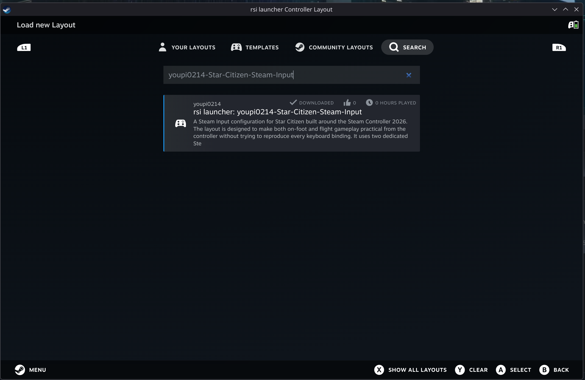

# Install the Controller Layout

First, [set up the RSI Launcher shortcut](setup.md). Then choose either installation method below.

## Method A — Community Layouts

1. Connect your controller.
2. Open **rsi launcher → Controller Layout** in Steam.
3. Click the current layout's name, then open **Community Layouts**.
4. Use the **Search** tab to search for **youpi0214-Star-Citizen-Steam-Input**.
5. Select the layout and choose **Apply Layout**.



## Method B — Manual installation

1. Download `controller_configuration.vdf` from the assets of the [latest release](https://github.com/youpi0214/Star-Citizen-Steam-Input/releases/latest).
2. Fully close Steam using **Steam → Exit**.
3. Copy the file into the appropriate folder below. Replace `<account_id>` with your account's numbered folder. Create the `rsi launcher` folder if necessary, and back up existing files before replacing them.

### Windows

```text
<Steam installation>\steamapps\common\Steam Controller Configs\<account_id>\config\rsi launcher\
```

### Linux / Steam Deck

```text
~/.local/share/Steam/steamapps/common/Steam Controller Configs/<account_id>/config/rsi launcher/
```

### Linux — Flatpak Steam

```text
~/.var/app/com.valvesoftware.Steam/.local/share/Steam/steamapps/common/Steam Controller Configs/<account_id>/config/rsi launcher/
```

4. Restart Steam and connect your controller.
5. Open **rsi launcher → Controller Layout → current layout's name → Your Layouts**.
6. Select the imported layout and choose **Apply Layout**.

The imported layout may appear under its internal title rather than its filename. Steam's storage locations can vary between client versions and installations.

## Verify the layout

Launch RSI Launcher through Steam. Confirm that **FPS Mode**, **Flight Mode**, and their **L4 Modifier** layers are present. Configure the [required in-game bindings](game-settings.md#required-in-game-bindings), then test the controls in Arena Commander or another safe environment.

If Steam uses desktop controls while the game is running, see [Linux troubleshooting](troubleshooting.md).

[Back to setup](setup.md) · [Next: in-game settings](game-settings.md) · [Back to README](../README.md)
