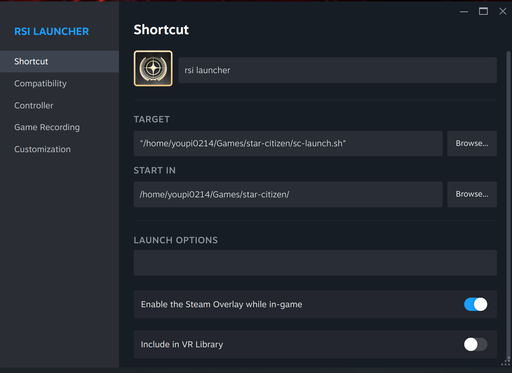
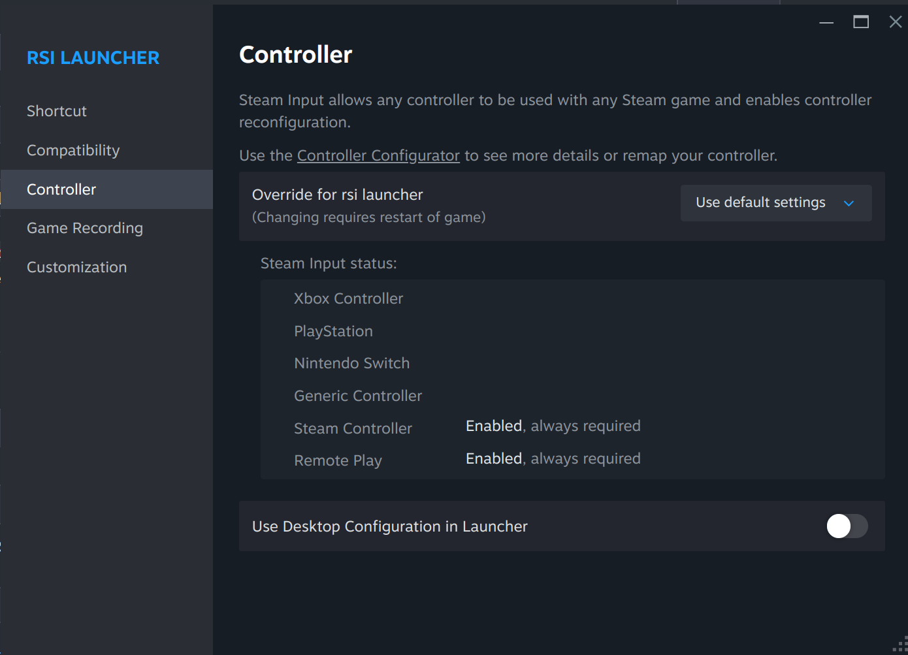

# Set Up RSI Launcher in Steam

Add the launcher to Steam before [installing the controller layout](installation.md).

## Add the non-Steam shortcut

1. In Steam, select **Games → Add a Non-Steam Game to My Library**.
2. Browse to the **RSI Launcher executable**, or your **Star Citizen launch script on Linux**, and add it.
3. Right-click the new shortcut and open **Properties → Shortcut**.
4. Configure the shortcut:

   | Setting | Value |
   | --- | --- |
   | Name | `rsi launcher` |
   | Target | Your launcher executable or Linux launch script |
   | Start In | The folder containing that executable or script |
   | Enable the Steam Overlay while in-game | On |

Use the exact name **`rsi launcher`** to help Steam find the community layout. This is the name used when publishing it. The overlay is also useful for displaying notifications when switching FPS and Flight action sets.

Use your own executable or script paths.

## Configure Steam Input

Under **Properties → Controller**, set:

| Setting | Value |
| --- | --- |
| Override for rsi launcher | Use default settings |
| Use Desktop Configuration in Launcher | Off |

**Launch RSI Launcher through this Steam shortcut when playing.**

## Optional library artwork

If you feel funky or simply just wanna make your new steam addition fit in with the rest of your steam library, give it some love under **Customization**, go crazy: [Star Citizen artwork on SteamGridDB](https://www.steamgriddb.com/game/5248257).

[Next: install the controller layout](installation.md) · [Back to README](../README.md)
