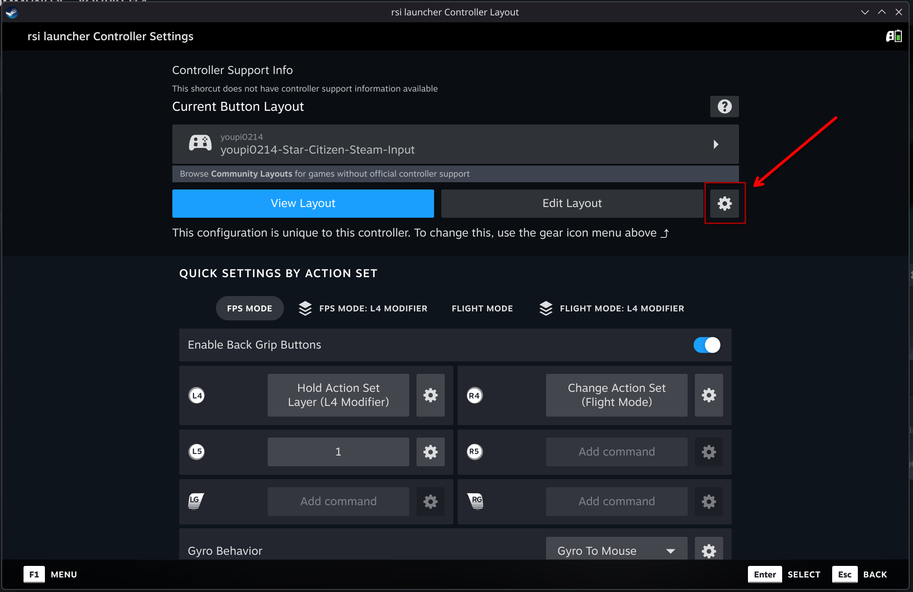
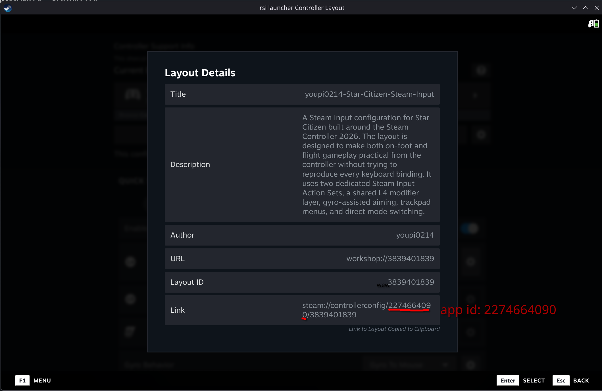

# Linux Troubleshooting

## Steam activates the Desktop Layout

Steam can sometimes activate its Desktop Layout while Star Citizen is running. First, check the [shortcut settings](setup.md#configure-steam-input) and [apply the controller layout](installation.md#method-a--community-layouts) to **rsi launcher**.

For **native Linux Steam**, the workaround below repeatedly requests the layout assigned to that shortcut. It uses whichever layout you have already applied, including your own modified mappings.

### Layout details and IDs

Open the gear menu beside **Edit Layout** to find **Layout Details**. The screenshot below highlights that menu and shows the layout's action sets.





For reference, my layout URI is:

```text
steam://controllerconfig/2274664090/3839401839
```

Here, `2274664090` is **my non-Steam shortcut app ID**, not yours. This URI is a reference, not a universal installation link. Use the [Community Layouts search steps](installation.md#method-a--community-layouts) to apply the layout to your own RSI Launcher shortcut.

The published **Layout ID** is `3839401839`. If you publish your own version, find its Layout ID under **Layout Details** and use that ID when sharing your version. The [Linux workaround](#find-your-shortcuts-app-id) requires your own shortcut's app ID, not my app ID or the published Layout ID.

The annotation shows **my app ID** as an example. Find your own shortcut's app ID using the [desktop shortcut method](#find-your-shortcuts-app-id).

### Find your shortcut's app ID

1. In Steam, right-click **rsi launcher → Manage → Add desktop shortcut**.
2. Open the generated `.desktop` file in a text editor.
3. Find the `Exec=` line containing:

   ```text
   steam://rungameid/XXXXXXXXXXXXXXXXXXXX
   ```

4. Copy the number after `rungameid/` and convert it to the shortcut's app ID:

   ```bash
   python3 -c 'print(int("PASTE_THE_NUMBER_AFTER_RUNGAMEID_HERE") >> 32)'
   ```

The printed result is **your non-Steam shortcut's app ID**. Do not use the published layout's ID (`3839401839`).

### Add the workaround

Open **rsi launcher → Properties → Shortcut → Launch Options** and paste:

```bash
bash -c 'setlayout() { env -u LD_PRELOAD -u LD_LIBRARY_PATH steam "steam://forceinputappid/$1" >/dev/null 2>&1; }; (while true; do setlayout YOUR_APP_ID; sleep 5; done) & p=$!; cleanup() { kill "$p" 2>/dev/null; wait "$p" 2>/dev/null; setlayout 413080; }; trap cleanup EXIT; "$@"' -- %command%
```

Replace `YOUR_APP_ID` with the shortcut app ID found above. Leave `413080` unchanged: it selects Steam's Desktop Configuration.

The wrapper:

- Requests the shortcut's selected layout every five seconds, including after controller reconnects.
- Keeps the game layout active while Alt+Tabbed, too.
- Requests the Desktop Layout again when the wrapped launch command exits.

**Keep RSI Launcher open while playing.** If your launch script exits while leaving the launcher or game running, cleanup happens at that earlier exit instead of when the game closes.

This command is intended for native Linux Steam. Flatpak may require a different invocation to communicate with its Steam client.

### Remove the workaround

Remove the wrapper from **Launch Options**. If the field was empty before, clear it; otherwise restore your previous launch options.

[Back to installation](installation.md) · [Back to README](../README.md)
