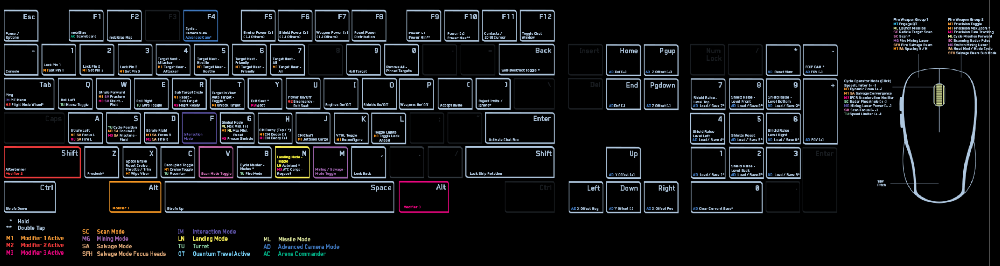

# Star Citizen — Suggested Quality-of-Life Settings

Suggested in-game settings changes to improve comfort and controller usability.

## Automatic Mouse Recentering

Switch to **Relative mouse mode** so steering input returns to center when you stop moving the mouse. It makes flying ships way more comfortable(!!)

### Configuration
1. Open **Options → Keybindings → Advanced Controls Customization**.
2. Select **Keyboard / Mouse**.
3. Expand **Flight – Movement**.
4. Find **Cycle mouse mode (VJoy / Relative)**, sometimes named **Change mouse mode (VJoy / Relative)**.
5. Assign **Period (`.`)** to match this layout, or choose another available key.
6. While piloting, press the assigned key to switch to **Relative** mode.

### Suggested binding
This layout uses **R5 → Period (`.`)** on a regular press. Period (`.`) was one of the few remaining unused in-game keys, making it a convenient choice without replacing an existing Star Citizen binding.

The current VDF includes this binding in **Flight Mode only**. While piloting, press R5 to cycle between VJoy and Relative mouse mode.

If `.` or R5 is already assigned in your setup, choose another available key or controller input. After changing the in-game **Cycle mouse mode** key, update the corresponding Steam Input binding to send that same key.

This is a toggle: press once to change mouse mode, then press again to switch back. No hold is required.

### Behavior
- **Relative:** steering input returns to center when mouse movement stops.
- **VJoy:** steering continues until you manually return the cursor to center.

### Default keyboard and mouse bindings

Use this reference to help choose an unused key. Colored labels indicate existing bindings, including actions available through modifiers or specific game modes. Check your in-game bindings before assigning a key, especially if you have customized them.

